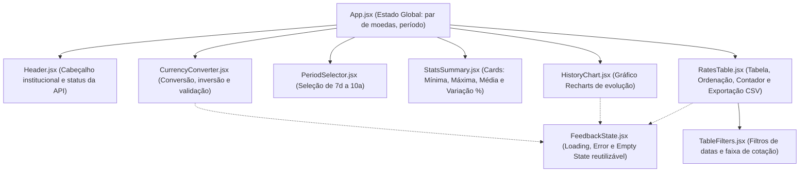

# Arquitetura e Mapeamento de Componentes — Currency Exchange App

## 1. Visão Geral da Arquitetura
A aplicação segue o modelo de **Single Page Application (SPA)** em React com componentes funcionais desacoplados e estilização isolada via **CSS Modules** (`*.module.css`).

O gerenciamento de estado aplica o conceito de **Lifting State Up** (elevação de estado):
- O par de moedas ativo (`baseCurrency` e `targetCurrency`) e o período histórico selecionado (`selectedPeriod`) ficam no componente raiz (`App.jsx`), pois são compartilhados entre o **Conversor de Moedas**, o **Gráfico de Histórico** e a **Tabela de Dados**.
- Estados específicos de uma única seção (como os campos de filtro e a ordenação da tabela) são mantidos localmente ou encapsulados em **Custom Hooks** (`useExchangeRate`, `useHistoricalRates`), mantendo os componentes limpos e coesos.

---

## 2. Hierarquia e Relação entre Componentes

---

## 3. Mapeamento Detalhado dos Componentes

| Componente | Responsabilidade | Arquivo JSX | Arquivo CSS Module | Principais Props | Estados Internos (`useState`) |
| :--- | :--- | :--- | :--- | :--- | :--- |
| **`App`** | Orquestrar o estado compartilhado (moeda origem, moeda destino e período), consumir os Custom Hooks da API e distribuir dados e callbacks para os componentes filhos. | `src/App.jsx` | `src/App.module.css` | *(Componente raiz — não recebe props)* | `baseCurrency` (`'USD'`), `targetCurrency` (`'BRL'`), `amount` (`'100'`), `selectedPeriod` (`'30d'`) |
| **`Header`** | Exibir a identidade visual da aplicação e subtítulo descritivo. | `src/components/Header/Header.jsx` | `src/components/Header/Header.module.css` | *(Sem props obrigatórias)* | *(Sem estado interno — Stateless)* |
| **`CurrencyConverter`** | Permitir selecionar as moedas de origem/destino, digitar o valor a converter, inverter o par de moedas, validar entradas inválidas e exibir o valor convertido, a taxa unitária e a data efetiva da cotação. | `src/components/CurrencyConverter/CurrencyConverter.jsx` | `src/components/CurrencyConverter/CurrencyConverter.module.css` | `currencies`, `baseCurrency`, `targetCurrency`, `amount`, `rateData`, `loading`, `error`, `onBaseChange`, `onTargetChange`, `onAmountChange`, `onSwapCurrencies`, `onRetry` | *(Controlado via props pelo `App` para sincronizar o par de moedas com o restante do dashboard)* |
| **`PeriodSelector`** | Renderizar a barra de botões dos 8 períodos históricos obrigatórios (`7d`, `15d`, `30d`, `3m`, `6m`, `1y`, `5y`, `10y`) e destacar o período ativo. | `src/components/PeriodSelector/PeriodSelector.jsx` | `src/components/PeriodSelector/PeriodSelector.module.css` | `periods`, `selectedPeriod`, `onSelectPeriod`, `disabled` | *(Sem estado interno — Stateless)* |
| **`StatsSummary`** | Apresentar cards analíticos resumindo o comportamento do par no período selecionado: Cotação Atual, Mínima, Máxima, Média e Variação Percentual (%). | `src/components/StatsSummary/StatsSummary.jsx` | `src/components/StatsSummary/StatsSummary.module.css` | `records`, `baseCurrency`, `targetCurrency`, `loading` | *(Sem estado interno — valores derivados dos registros)* |
| **`HistoryChart`** | Exibir o gráfico responsivo de área/linha (via `Recharts`) com a evolução histórica da taxa de câmbio no período selecionado, incluindo tooltip formatado com data e cotação. | `src/components/HistoryChart/HistoryChart.jsx` | `src/components/HistoryChart/HistoryChart.module.css` | `records`, `baseCurrency`, `targetCurrency`, `selectedPeriodLabel`, `loading`, `error`, `onRetry` | *(Sem estado interno — Stateless)* |
| **`TableFilters`** | Disponibilizar os controles de filtro da tabela: data inicial, data final, cotação mínima, cotação máxima e botão de limpar filtros, além de avisos de validação de intervalos. | `src/components/TableFilters/TableFilters.jsx` | `src/components/TableFilters/TableFilters.module.css` | `filters`, `minAvailableDate`, `maxAvailableDate`, `validationError`, `hasActiveFilters`, `onFilterChange`, `onClearFilters` | *(Controlado por `RatesTable`)* |
| **`RatesTable`** | Exibir a tabela histórica (Data, Moeda de Origem, Moeda de Destino, Cotação), coordenar os filtros (`TableFilters`), aplicar ordenação (Data/Cotação), exibir o contador de registros encontrados e acionar a exportação CSV. | `src/components/RatesTable/RatesTable.jsx` | `src/components/RatesTable/RatesTable.module.css` | `records`, `baseCurrency`, `targetCurrency`, `selectedPeriod`, `loading`, `error`, `onRetry` | `filters` (`{ startDate, endDate, minRate, maxRate }`), `sortConfig` (`{ field: 'date', direction: 'desc' }`) |
| **`FeedbackState`** | Componente utilitário para padronizar a exibição visual dos estados de **Loading** (spinner/skeleton), **Erro** (com botão de tentar novamente) e **Empty State** (ausência de registros). | `src/components/FeedbackState/FeedbackState.jsx` | `src/components/FeedbackState/FeedbackState.module.css` | `type` (`'loading' \| 'error' \| 'empty'`), `title`, `message`, `onAction`, `actionLabel` | *(Sem estado interno — Stateless)* |

---

## 4. Custom Hooks, Serviços e Utilitários

Além dos componentes visuais, a lógica de negócios e de integração com a API é separada em camadas dedicadas:

| Camada / Arquivo | Tipo | Responsabilidade |
| :--- | :--- | :--- |
| `src/constants/periods.js` | Constantes | Define a lista dos 8 períodos históricos (`7d`, `15d`, `30d`, `3m`, `6m`, `1y`, `5y`, `10y`) com seus rótulos e unidades de cálculo de data. |
| `src/services/frankfurterApi.js` | Serviço de API | Centraliza as chamadas HTTP (`fetch` + `async/await`) para os endpoints da API Frankfurter (`/v2/currencies`, `/v2/rate/{base}/{quote}` e `/v2/rates`). |
| `src/hooks/useCurrencies.js` | Custom Hook | Gerencia o carregamento inicial da lista de moedas disponíveis (`currencies`, `loading`, `error`). |
| `src/hooks/useExchangeRate.js` | Custom Hook | Busca e atualiza a cotação mais recente sempre que `baseCurrency` ou `targetCurrency` mudam, controlando `loading`, `error` e função `refetch`. |
| `src/hooks/useHistoricalRates.js` | Custom Hook | Busca a série histórica de cotações sempre que `baseCurrency`, `targetCurrency` ou `selectedPeriod` mudam. |
| `src/utils/currencyUtils.js` | Utilitário JS | Funções puras para validação de valor numérico, cálculo de conversão, estatísticas do período (mínima, máxima, média, variação) e formatação de números/moedas. |
| `src/utils/dateUtils.js` | Utilitário JS | Funções puras para cálculo do intervalo de datas (`from` e `to` no formato `YYYY-MM-DD`) de cada período histórico e formatação de datas para `DD/MM/AAAA`. |
| `src/utils/filterAndSortUtils.js` | Utilitário JS | Funções puras para validação e aplicação combinada dos filtros (datas e faixa de cotação) e ordenação por data ou cotação. |
| `src/utils/csvExport.js` | Utilitário JS | Geração do conteúdo CSV com cabeçalhos, bloqueio de lista vazia, formatação de nome de arquivo identificável e disparo do download via `Blob` no navegador. |
